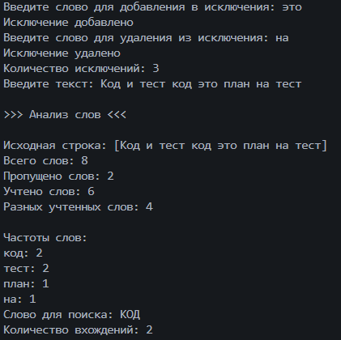

# Практическая работа №22

Автор: Белоярова Александра
Группа: ИСП-251

## Тема

Dictionary и HashSet в C#.

## Что реализовано

- хранение исключений в HashSet;
- добавление и удаление исключений;
- подготовка и разделение текста на слова;
- подсчёт частот в Dictionary;
- вывод общей статистики;
- безопасный поиск слова через TryGetValue.

## Короткие ответы

1. Что должно быть уникальным в Dictionary и в HashSet?

Ответ: В Dictionary уникальными должны быть ключи. В HashSet уникальным является каждый элемент множества

2. Чем отличается повторное добавление в HashSet от Dictionary.Add() с существующим ключом?

Ответ: HashSet.Add() при повторном добавлении просто возвращает false и не изменяет множество. Dictionary.Add() с уже существующим ключом вызывает исключение

3. Почему для поиска по неизвестному ключу удобно использовать TryGetValue()?

Ответ: TryGetValue() не бросает исключение если ключа нет, а возвращает false. Одним вызовом получаем и проверку наличия ключа и значение без риска аварийного завершения программы

## Результат
